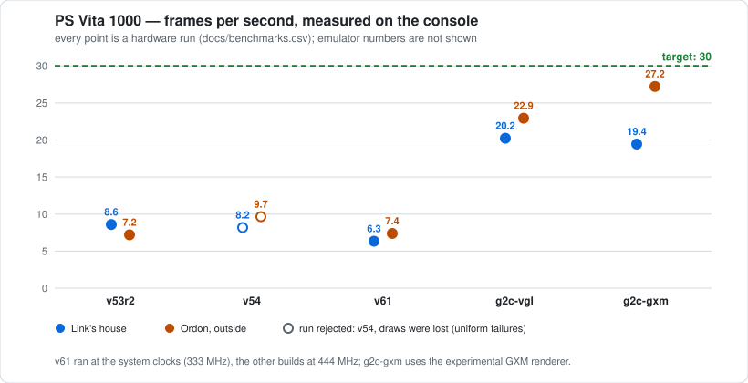
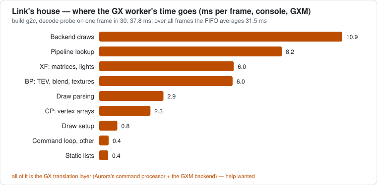

# DuskOnVita

A fan port of **The Legend of Zelda: Twilight Princess** to the PlayStation Vita. Unofficial, and
very much a work in progress.

- Not affiliated with or endorsed by Nintendo, Sony, the Dusklight team or the zeldaret project.
- Built on [Dusklight](https://github.com/TwilitRealm/dusklight), the native build of the
  [Twilight Princess decompilation](https://github.com/zeldaret/tp). The name is a nod to Dusklight.
- No game data in here. You bring your own legally obtained copy of the game.

The game's own code runs natively on the Vita's ARM CPU, no emulation involved. This repo is the
Vita side of things: a renderer that turns Aurora's GX commands into GXM (or
[vitaGL](https://github.com/Rinnegatamante/vitaGL)), audio, input, memory, a lot of logging, and a
small stack of patches on top of the pinned upstreams.

## Where it's at (28 Oct 2026)

- **You can play it, but it's not comfy yet.** On my PS Vita 1000 it boots from your disc image to
  the title screen, a new game starts, the opening in Ordon plays, and saving works.
- **It's slow.** 12 to 28 FPS in the places I've measured, where the original runs at 30. The game
  keeps its normal speed down to 15 FPS; below that, everything slows down with it.
- **Not there yet:** the minimap and map screens, Link's real-time shadow, water effects, bloom and
  depth of field (everything that needs frame-buffer copies). No settings menu either (options live
  in text files), and no language picker.
- **Known bugs:** some textures flicker.
- **Not tested yet:** dungeons, the rest of the story, a full playthrough, sleep and resume, and any
  disc other than the European one.

The goal is a steady 30 FPS. What I'm working on next is in [docs/ROADMAP.md](docs/ROADMAP.md).
It's all open so anyone can reproduce it, poke at it and help out.

## Numbers (on a real PS Vita 1000)

Latest console session (28 Oct, build b2): six of the busiest places in the game, each loaded with
`--stage`, drawn at 75 % with the default play profile ([docs/PERFORMANCE.md](docs/PERFORMANCE.md)).
FPS with Link standing still / walking a scripted route:

| Place | FPS | What holds it back |
| --- | ---: | --- |
| Ordon, outside Link's house (`F_SP103,1,3,-1`) | 27.9 / 27.4 | GX worker |
| Castle Town, twilight (`F_SP116,0,0,-1`) | 21.7 / 19.4 | main thread |
| Faron fight (`F_SP108,6,1,0`) | 18.3 / 14.6 | main thread |
| Hyrule Field bridge (`F_SP121,0,4,-1`) | 17.6 / 19.2 | main thread and GX worker |
| Kakariko, twilight (`F_SP109,0,59,-1`) | 12.1 / 12.7 | main thread |
| Ordon village centre (`F_SP103,0,23,-1`) | 11.9 / 12.5 | main thread |

The game now ticks at a fixed 30 Hz (two ticks per frame at most), so it keeps its real speed down to
15 FPS; four of these six places held 28-30 ticks per second. At 75 % the GPU has room to spare. The
bottleneck is the main thread, mostly actors updating (crowds, fish, a few enemies) and the game's
painter. How these runs are done: [docs/PERFORMANCE.md](docs/PERFORMANCE.md), "Bench of crowded
places".

Older runs, build g2c at 444 MHz, FPS:

| Scene | vitaGL | GXM + G2 |
| --- | ---: | ---: |
| Link's house | 20.2 | 19.4 |
| Ordon, outside Link's house | 22.9 | 27.2 |
| Faron fight | 11.7 | 14.0 |

GXM + G2 is the native renderer (`--vita-gpu=gxm`, the default now) with resident geometry, packed
vertex formats and native primitives. For scale: build v61 (one core, stock clocks) did 6.3 FPS in
the house and 7.4 outside, on 22 Oct.

Every number here comes from the console itself, averaged over steady stretches (Link on screen for
10 s, no shader compiling; `tools/vita_run_report.py`). The emulator is only for checking that things
look right, never for speed. All the runs are in [docs/benchmarks.csv](docs/benchmarks.csv), and
`python3 tools/charts.py` redraws the charts from it.



Link's house turned out to be GPU-bound at full resolution, which is why the default is 75 % now.
Where the GX worker's time went in the house on g2c:



## What works

| Area | State | Notes |
| --- | --- | --- |
| Title screen, new game, the opening in Ordon | ✅ | played on the console (28 Oct); title and file select around 21 FPS, Ordon around 23 |
| Saves | ✅ | saving and the rolling backups work on the console; the repair check at boot and save import ([docs/ARCHITECTURE.md](docs/ARCHITECTURE.md), "Saves") are checked in the emulator and host tests |
| Link's house, Ordon, the Faron fight | ✅ | loaded with `--stage` |
| Castle Town, Kakariko, Hyrule Field | ⚠️ | they run, at 12-22 FPS |
| Full-width 16:9 picture | ✅ | drawn at 75 % (720x408) and scaled to 960x544; `--vita-gxm-scale=100` for full size |
| GXM renderer | ✅ | the default; `--vita-profile=off` goes back to vitaGL |
| Real game speed | ✅ | fixed 30 game ticks per second, held down to 15 FPS |
| Controls (both sticks, buttons) | ✅ | |
| PlayStation button prompts | ✅ | symbols drawn in code over the game's button art, no Sony or Nintendo artwork |
| Front touch in menus, gyro aim | ✅ | work on the console |
| 3D lock-on marker | ✅ | works on the console |
| Start-up screens | ✅ | the progress screen while shaders get ready works on the console; the error screens (no disc, wrong disc, missing shader compiler) are checked in the emulator |
| Shader preparation | ⚠️ | shaders compile the first time they're needed, which stalls; an optional warm-up file moves that to start-up |
| 3D scenes (textured, lit, fog) | ⚠️ | some textures flicker |
| Frame-buffer effects (minimap, map, Link's shadow, water, bloom, depth of field, heat haze) | ❌ | EFB copies and off-screen passes aren't in yet; draws that would read an empty copy are skipped rather than drawn black |
| Dungeons, a full playthrough | ❔ | not tested |

## What you need

- A homebrew-enabled PS Vita with VitaShell.
- Your own GameCube disc image as a plain `.iso`/`.gcm` (RVZ, WIA, CISO and other containers don't
  work yet). I develop and test with the European release, **GZ2P01, revision 0**; other releases
  haven't been tried on this port.
- The shader compiler module `ur0:data/libshacccg.suprx`, extracted on your own console.

## Build

You'll want Linux or WSL2 with Docker, Git, Bash, Python 3, rsync, patch, curl and unzip. Keep the
checkout on the Linux side (for example `~/src/duskonvita`) so file modes and LF line endings stay
intact.

```sh
git submodule update --init external/dusklight
git -C external/dusklight submodule update --init extern/aurora extern/borealis
docker pull vitasdk/vitasdk@sha256:8227da1b596d981f4513cd9b36bda1e43857f6dae5bcf4312c1cd40167f7d9bb
bash tools/vita_build.sh build-vita
```

`tools/vita_build.sh` copies the repo into a work tree (`TWV_WORK`, default `~/twilight-vita-work`),
applies `patches/` there (the submodules stay untouched), downloads the hash-pinned sources from
`deps.lock`, and builds inside the digest-pinned VitaSDK image with networking off. It never
downloads game data. You get `build-vita/twilight_vita.vpk`; `link_report.txt` next to it lists the
symbols that are still trap stubs.

For measuring, build the performance VPK instead: `bash tools/vita_perf_build.sh` compiles in every
start-up renderer switch (each off unless you pick it) and leaves out the per-draw diagnostics
([docs/PERFORMANCE.md](docs/PERFORMANCE.md)).

## Run

1. Install the VPK with VitaShell.
2. Copy your disc image to `ux0:data/twilight-vita/game.iso`.
3. Copy `args.example` to `ux0:data/twilight-vita/args.txt` (it starts in Link's house).
4. Launch **DuskOnVita (dev)**.

`args.txt` takes whitespace-separated options, 511 bytes at most, no quoting or comments. Stage
syntax: `--stage=STAGE,ROOM,SPAWN,LAYER`. A `sequence.txt` in the same folder runs a list of
configurations, one per launch. Each run adds its logs to `ux0:data/twilight-vita/runtime.jsonl`;
Dusklight's own logs and caches go to `ux0:data/TwilitRealm/Dusklight/`. The port keeps backups of
your saves now, but an extra copy somewhere else never hurts.

## Controls

| Vita | GameCube |
| --- | --- |
| Left stick / right stick | control stick / C stick |
| Cross / Circle | A / B |
| Square / Triangle | X / Y |
| L / R | L / R (targeting on L) |
| Select | Z |
| Start, D-pad | Start, D-pad |

Button prompts show the PlayStation symbols. In menus you can tap the front touch screen. Aiming
also follows the gyro (on by default; the game's gyro aim setting turns it off).

## Measuring

Speed claims need a console run. [docs/PERFORMANCE.md](docs/PERFORMANCE.md) has every switch and
log field, and how I measure: one change per run, same scene, a fixed run length
(`--vita-exit-after`), loading and shader compiling kept out of the numbers, and
`tools/vita_run_report.py` to turn `runtime.jsonl` into one row per run.

## Tests

`bash tools/host_tests.sh` builds and runs the host tests (Linux or WSL, a C++20 compiler with
AddressSanitizer and UndefinedBehaviorSanitizer, Python 3; about 5 to 15 minutes). It needs the
submodules: a lot of the tests pull the real functions out of the pinned upstream sources and this
port's code, and compare them with frozen earlier versions in `tests/fixtures/baseline/`. They don't
prove anything about the picture on the GPU or speed on the console.

## Want to help?

- **The main thread:** in towns and busy places it's the bottleneck. Actor updates (crowds, fish,
  some enemies) and the game's painter take most of it. Profiles and exact speed-ups are very welcome,
  as long as the game behaves exactly like the original.
- **Frame-buffer effects:** EFB copies and off-screen passes on GXM, for the minimap, the map screen,
  shadows and bloom.
- **Texture flicker:** still hunting the cause; a matched Dolphin capture of the same scene helps.
- **Testing on hardware:** a Vita 1000 or 2000 (or a PSTV), the place, the build and your
  `runtime.jsonl`.

[CONTRIBUTING.md](CONTRIBUTING.md) has the ground rules,
[docs/ARCHITECTURE.md](docs/ARCHITECTURE.md) explains how the port fits together, and
[docs/ROADMAP.md](docs/ROADMAP.md) is what's coming.

## Credits and license

None of this would exist without the [zeldaret/tp](https://github.com/zeldaret/tp) decompilation,
[Dusklight](https://github.com/TwilitRealm/dusklight), [Aurora](https://github.com/encounter/aurora),
[Borealis](https://github.com/encounter/borealis), [VitaSDK](https://vitasdk.org) and
[vitaGL](https://github.com/Rinnegatamante/vitaGL). [NOTICE](NOTICE) lists every upstream with its
pinned version and license.

The original code in this repo is under the [MIT license](LICENSE). Upstream projects and
dependencies keep their own licenses, and a patch doesn't change the license of the file it applies
to. vitaGL is LGPL-3.0-or-later: its pinned source, the local patches and the build recipe are all
here, so it can be rebuilt and relinked.

The Legend of Zelda and Twilight Princess are trademarks of Nintendo. This repo contains no game disc
image, extracted game data, Nintendo or Sony software, or shader compiler binary.
