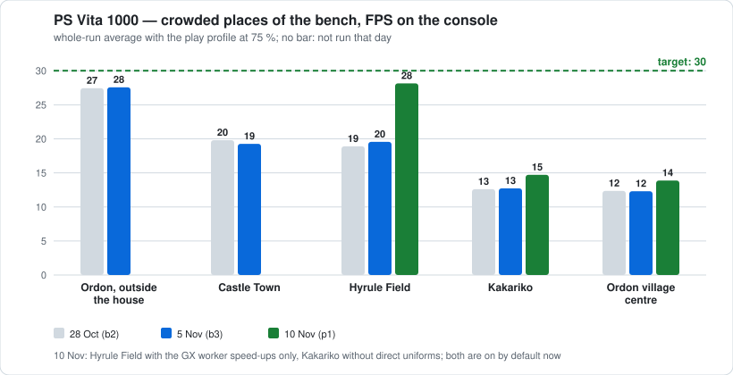
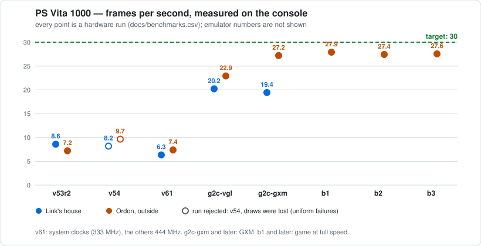

# DuskOnVita

A fan port of **The Legend of Zelda: Twilight Princess** to the PlayStation Vita. Unofficial, and
very much a work in progress.

- Not affiliated with or endorsed by Nintendo, Sony, the Dusklight team or the zeldaret project.
- Built on [Dusklight](https://github.com/TwilitRealm/dusklight), the native build of the
  [Twilight Princess decompilation](https://github.com/zeldaret/tp). The name is a nod to Dusklight.
- No game data in here. You bring your own legally obtained copy of the game.

The game's own code runs natively on the Vita's ARM CPU, no emulation involved. This repo is the
Vita side of things: a renderer that turns Aurora's GX commands into GXM (or
[vitaGL](https://github.com/Rinnegatamante/vitaGL)), audio, input, memory, a lot of logging, and a
small stack of patches on top of the pinned upstreams.

## Where it's at (14 Nov 2026, version 0.9.0)

- **You can install it and play, but it's not comfy yet.** On my PS Vita 1000 it boots from your
  disc image to the title screen, a new game starts, the opening in Ordon plays, and saving works.
- **It's getting faster, but it's not there yet.** 10 to 29 FPS in the places I've measured, where
  the original runs at 30. The villages are the slowest: Ordon 14 to 16 FPS and about 10 when you
  stand in the middle and look across the whole village, Kakariko 18 to 19. The game keeps its
  normal speed down to 15 FPS; below that, everything slows down with it.
- **New on 14 Nov:** the map screens draw their map (the dungeon map with its rooms and doors, the
  field map with its terrain and zoom; the minimap in play is still off), and a crash at area
  changes is fixed (the game could stop when entering an area or restarting after a fall).
- **New on 13 Nov, speed:** seven more exact speed-ups on by default after console sessions. Rows
  of identical squares go out as one draw (the Palace of Twilight went from 7 to 13 FPS, Snowpeak
  Ruins room 9 from 9 to 19), a simple shadow is one draw, the sound is rendered in small steps
  (late sound buffers fell from 29 % to 0.2 % in the Palace of Twilight), and four smaller ones:
  repeated register writes are skipped, child particles go out ten per draw, the room background
  isn't drawn twice, and the pad values come from SDL's events.
- **New on 13 Nov:** comfort options on the settings page, all off by default so the game stays
  as it was made: auto-save, instant text, quick transform (R + Triangle), faster climbing, iron
  boots and Tears of Light, bigger wallets, an aiming reticle, HUD size, and more; a Challenge
  section (double damage, no heart drops) and a few cheats. The page now has sections (L and R), a
  "Restart the game" entry, and a short screen on the first launch that says where it all is.
- **New on 11 and 12 Nov:** the HUD's button icons sit as the Vita's buttons do (Square left,
  Circle right) and read better on a bright background, SELECT is drawn as the button's shape, a
  free camera setting, an icon and LiveArea pictures, more exact speed-ups on by default, and a
  crash fixed when entering some areas of Hyrule Field.
- **New on 10 Nov:** exact speed-ups for the renderer's worker thread and the game's model maths, on
  by default, and a Speed-ups setting (Original or Performance) that skips work you can't see.
- **New on 5 Nov:** an in-game settings page (two fingers held on the rear touch pad, or three on the screen), your disc as `.iso`, `.ciso`
  or `.gcz`, the game in your Vita's language, and Cross/Circle following your Vita's Enter button.
- **Not there yet:** the minimap in play, Link's real-time shadow, water effects, bloom and
  depth of field (everything that needs frame-buffer copies).
- **Known bugs:** some textures flicker; the first visit to an area stutters while its shaders
  compile (0.4 s each on the console).
- **Not tested yet:** the story past Ordon and a full playthrough (every room of the game loads in
  the emulator, but loading is not playing), sleep and resume, and any disc other than the European
  one.

The goal is a steady 30 FPS. What I'm working on next is in [docs/ROADMAP.md](docs/ROADMAP.md).
It's all open so anyone can reproduce it, poke at it and help out.

## Numbers (on a real PS Vita 1000)

Latest console sessions (5, 10 and 11 Nov): six of the busiest places in the game, each loaded
with `--stage`, drawn at 75 % with the default play profile
([docs/PERFORMANCE.md](docs/PERFORMANCE.md)). FPS with Link standing still / walking a scripted
route:

| Place | 5 Nov | 10 Nov | 11 Nov | What holds it back now |
| --- | ---: | ---: | ---: | --- |
| Ordon, outside Link's house (`F_SP103,1,3,-1`) | 28.5 / 27.4 | 28.8 (run average) | 29.5 / 28.7 | GX worker |
| Hyrule Field bridge (`F_SP121,0,4,-1`) | 18.3 / 19.7 | 28.1 / 28.2 | **29.1 / 29.1** | main thread |
| Castle Town, twilight (`F_SP116,0,0,-1`) | 21.1 / 18.9 | not run | **27.0 / 25.5** | main thread |
| Faron fight (`F_SP108,6,1,0`), run average | 11.7 | 14.5 | 14.6 | main thread and GX worker |
| Kakariko, twilight (`F_SP109,0,59,-1`) | 12.2 / 12.9 | 14.0 / 14.9 | 14.9 / 16.8 | GX worker and main thread |
| Ordon village centre (`F_SP103,0,23,-1`) | 11.9 / 12.4 | 13.3 / 14.0 | 13.6 / 14.6 (10 Nov, evening) | GX worker and main thread |

The 11 Nov column was measured with the pad values taken from SDL's events, a default since
13 Nov. In free play on 12 Nov the village read between 11 and 18 FPS, and 9 to 10 in its
widest view: the bench camera in the village centre is not the worst one.

The heaviest places, console session of 13 Nov, at normal game speed, with the speed settings
0.9.0 ships (the seven defaults of that day):

| Place | FPS | Game speed | Late sound buffers |
| --- | ---: | ---: | ---: |
| Snowpeak Ruins, room 9 (`D_MN11`) | 19.3 | 100 % | 0 |
| Kakariko, twilight (`F_SP109,0,59,-1`) | 17.6 standing / 18.8 walking | 100 % | 0 |
| Ordon village centre (`F_SP103,0,23,-1`) | 14.0 standing / 15.9 walking | 94 to 98 % | 0 |
| Hyrule Field, the enemy areas (rooms 1, 7, 10, 13) | 14.5 | 82 % | 26 % |
| Palace of Twilight, entrance (`D_MN08`) | 13.7 | 90 % | 0.2 % |
| Ordon village, its widest view | 9.9 | 66 % | 0 |

That session ran on a build made just before this version's settings page and HUD work, with a
prepared shader set, which a release doesn't ship (a first visit compiles its shaders). In every
one of these places the main thread is the limit.

What changed on 10 Nov, all exact and on by default: the GX worker (the thread that turns the game's
GX commands into GXM draws) no longer checks again a pipeline that didn't change, no longer receives
the minimap the renderer can't draw yet, and writes uniforms straight into GPU memory; the game's
matrix products, weight envelopes, actor searches, hair and random numbers have faster paths with
the same results bit for bit. Hyrule Field was measured with only the GX worker part on, Kakariko
without the direct uniforms; both are on now. Part of the field's gain comes from not sending the
minimap: once the minimap is drawn again, it has to be redrawn only when it changes, or some of that
gain goes.

With Speed-ups set to Performance (settings page), Ordon village centre ran at 14.1 / 16.0 FPS,
against 12.6 / 13.2 with the same GX worker speed-ups and Original.

The game ticks at a fixed 30 Hz (two ticks per frame at most), so it keeps its real speed down to
15 FPS. At 75 % the GPU has room to spare (23-27 ms per frame). The limits are the main thread (the
game's actors and its painter) and the GX worker. How these runs are done:
[docs/PERFORMANCE.md](docs/PERFORMANCE.md), "Bench of crowded places". A pair is the bench report's
figure for each phase of the scripted route (`tools/vita_bench_report.py`); a single figure is the
run average over steady windows (`tools/vita_run_report.py`), which is what
[docs/benchmarks.csv](docs/benchmarks.csv) holds.

The Faron line was wrong here until 14 Nov. Its run leaves Faron Woods after about eight timing
windows and plays the rest in the Forest Temple (`D_MN05` room 22), and the pair shown for it
on 11 Nov (22.2 / 20.4) was the temple's part; the 5 Nov pair (18.3 / 14.5) was read the same way. In Faron Woods itself the fight ran at
about 14.5 FPS on 10 and 11 Nov; the temple part measured about 20.



Older runs, build g2c at 444 MHz, FPS:

| Scene | vitaGL | GXM + G2 |
| --- | ---: | ---: |
| Link's house | 20.2 | 19.4 |
| Ordon, outside Link's house | 22.9 | 27.2 |
| Faron fight | 11.7 | 14.0 |

GXM + G2 is the native renderer (`--vita-gpu=gxm`, the default now) with resident geometry, packed
vertex formats and native primitives. For scale: build v61 (one core, stock clocks) did 6.3 FPS in
the house and 7.4 outside, on 22 Oct.

Every number here comes from the console itself, averaged over steady stretches (Link on screen for
10 s, no shader compiling; `tools/vita_run_report.py`). The emulator is only for checking that things
look right, never for speed. All the runs are in [docs/benchmarks.csv](docs/benchmarks.csv), and
`python3 tools/charts.py` redraws the charts from it.



Link's house turned out to be GPU-bound at full resolution, which is why the default is 75 % now.
Where the GX worker's time went in the house on g2c:


## What works

| Area | State | Notes |
| --- | --- | --- |
| Title screen, new game, the opening in Ordon | ✅ | played on the console (28 Oct); title and file select around 21 FPS, Ordon around 23 |
| Saves | ✅ | saving and the rolling backups work on the console; the repair check at boot and save import ([docs/ARCHITECTURE.md](docs/ARCHITECTURE.md), "Saves") are checked in the emulator and host tests |
| Link's house, Ordon, the Faron fight | ✅ | loaded with `--stage` |
| Castle Town, Kakariko, Hyrule Field | ⚠️ | they run: open Hyrule Field at 29 FPS, Castle Town 25 to 27, Kakariko 18 to 19, the field's enemy areas around 14 |
| Full-width 16:9 picture | ✅ | drawn at 75 % (720x408) and scaled to 960x544; `--vita-gxm-scale=100` for full size |
| GXM renderer | ✅ | the default; `--vita-profile=off` goes back to vitaGL |
| Real game speed | ✅ | fixed 30 game ticks per second, held down to 15 FPS |
| Controls (both sticks, buttons) | ✅ | |
| PlayStation button prompts | ✅ | symbols drawn in code over the game's button art, no Sony or Nintendo artwork; SELECT is the button's oval |
| HUD button positions | ✅ | Square is drawn left of Cross and Circle right, as on the Vita; "Original" in the settings puts the GameCube's places back. Seen on the console; not yet with every item |
| Settings page | ✅ | two fingers held on the rear touch pad, or three on the screen; presets, render size, FPS counter, prompts, HUD button positions, confirm button, language, gyro, free camera, comfort options, camera invert. Works on the console |
| Icon and LiveArea pictures | ✅ | drawn in code by `tools/make_livearea.py`, no artwork from anyone |
| Speed-ups (Original / Performance) | ⚠️ | off by default. Performance skips work you can't see: the frame that isn't shown, animals off screen or far away, part of the Castle Town crowd. Quests, items and saves are unchanged; random idle choices can differ. On the console: Ordon village centre 14.1 / 16.0 FPS instead of 12.6 / 13.2 |
| Disc images: ISO, CISO, GCZ | ⚠️ | read in place, any name, region from the disc; checked in the emulator with the European disc |
| Your Vita's language and Enter button | ⚠️ | text in the console's language when the disc has it, Circle confirms when the Vita does (prompts follow); checked in the emulator |
| Front touch in menus, gyro aim | ✅ | work on the console |
| 3D lock-on marker | ✅ | works on the console |
| Start-up screens | ✅ | the progress screen while shaders get ready works on the console; the error screens (no disc, wrong disc, missing shader compiler) are checked in the emulator |
| Shader preparation | ⚠️ | shaders compile the first time they're needed, which stalls; an optional warm-up file moves that to start-up |
| 3D scenes (textured, lit, fog) | ⚠️ | some textures flicker |
| Map screens (dungeon map, field map) | ✅ | the game's own map pass, drawn on the CPU; work on the console |
| Frame-buffer effects (minimap, Link's shadow, water, bloom, depth of field, heat haze) | ❌ | EFB copies and off-screen passes aren't in yet; draws that would read an empty copy are skipped rather than drawn black |
| Dungeons, a full playthrough | ❔ | every room of the game loads in the emulator, and two dungeon rooms were visited on the console; the story past Ordon has not been played |

## What you need

- A homebrew-enabled PS Vita with VitaShell.
- Your own dump of the GameCube disc as `.iso`, `.ciso` or `.gcz` (RVZ, WIA, WBFS and NKit images
  aren't read: convert them to ISO first, for example with Dolphin's Convert File). I develop and
  test with the European release, **GZ2P01, revision 0**; the USA (GZ2E01) and Japanese (GZ2J01)
  releases are accepted but haven't been tried on this port.
- The shader compiler module `ur0:data/libshacccg.suprx`, extracted on your own console.

## Build

You'll want Linux or WSL2 with Docker, Git, Bash, Python 3, rsync, patch, curl and unzip. Keep the
checkout on the Linux side (for example `~/src/duskonvita`) so file modes and LF line endings stay
intact.

```sh
git submodule update --init external/dusklight
git -C external/dusklight submodule update --init extern/aurora extern/borealis
docker pull vitasdk/vitasdk@sha256:8227da1b596d981f4513cd9b36bda1e43857f6dae5bcf4312c1cd40167f7d9bb
bash tools/vita_build.sh build-vita
```

`tools/vita_build.sh` copies the repo into a work tree (`TWV_WORK`, default `~/twilight-vita-work`),
applies `patches/` there (the submodules stay untouched), downloads the hash-pinned sources from
`deps.lock`, and builds inside the digest-pinned VitaSDK image with networking off. It never
downloads game data. You get `build-vita/twilight_vita.vpk`; `link_report.txt` next to it lists the
symbols that are still trap stubs.

To play or to measure, build the performance VPK instead (the releases are this build):
`bash tools/vita_perf_build.sh` compiles in every start-up renderer switch, so the default play
profile can use them, and leaves out the per-draw diagnostics
([docs/PERFORMANCE.md](docs/PERFORMANCE.md)).

## Install

1. Install the VPK from the [release page](https://github.com/NathanKneT/DuskOnVita/releases) with
   VitaShell, or from [VitaDB](https://www.rinnegatamante.eu/vitadb/#/info/1805): on the Vita,
   search for DuskOnVita in VitaDB Downloader.
2. Put the shader compiler at `ur0:data/libshacccg.suprx`. It comes from your own console's system
   files: extract it with the ShaRKBR33D app. Without it the game shows a screen saying so.
3. Copy your disc image into `ux0:data/twilight-vita/` (the game creates the folder the first time
   it starts, or create it yourself). Any name works; `game.iso` is looked at first. If you already
   keep the disc in `ux0:data/dusklight/` (`Zelda.iso` or `Zelda.ciso`), it's found there too, and
   so is a `data/twilight-vita/` folder on a second storage device (`uma0:`, `imc0:` or `xmc0:`).
   Images are read where they are, never copied.
4. Launch **DuskOnVita** (a build of your own is named "DuskOnVita (dev)").

There's no shader pack in the release (it would be derived from the game's materials). So the first
time you visit an area, the game stutters for a while as the Vita compiles its shaders; they're
cached, and the next visit is smooth. Saves go to `ux0:data/twilight-vita/<region>/Card A/`, with
three rolling backups; an extra copy somewhere else never hurts. They're ordinary `.gci` files, the
format Dolphin and Dusklight on a PC use: to bring a save over, put its `.gci` in
`ux0:data/twilight-vita/import/` before the first start (it's copied in when the card has no save
yet). If something's wrong with the disc
image (missing, cut short, a format the port can't read, another game), a screen says what and
where.

For testing, `args.txt` in the same folder takes extra options (whitespace-separated, 511 bytes at
most, no quoting or comments), for example `--stage=STAGE,ROOM,SPAWN,LAYER` to start somewhere; see
`args.example`. A `sequence.txt` runs a list of configurations, one per launch. Each run adds its
logs to `ux0:data/twilight-vita/runtime.jsonl`; Dusklight's own logs and caches go to
`ux0:data/TwilitRealm/Dusklight/`.

## Controls

| Vita | GameCube |
| --- | --- |
| Left stick / right stick | control stick / C stick |
| Cross / Circle | A / B (swapped when your Vita confirms with Circle) |
| Square / Triangle | X / Y |
| L / R | L / R (targeting on L) |
| Select | Z |
| Start, D-pad | Start, D-pad |
| Start + Square + Circle, held | Start + X + B: back to the title screen, as on the GameCube |

Button prompts show the PlayStation symbols, and the HUD draws Square left of Cross and Circle
right, as the buttons sit on the Vita. In menus you can tap the front touch screen. Aiming also
follows the gyro (on by default).

**Settings:** hold two fingers still on the rear touch pad for a second, or tap the screen with
three fingers (the first launch shows a screen that says so). The game pauses and a page opens,
in sections you change with L and R: a preset (Quality 100 %, Balanced 75 %, Battery
50 % with the console's own clocks), render size, Speed-ups (Original or Performance, or each of
the four on its own), an FPS counter, button prompts (PlayStation or GameCube), HUD button
positions (Vita pad or Original), the confirm button (System, Cross or Circle), the language (from
the ones on your disc), gyro aim, sensitivity, invert and recentre, the free camera (off is the
original camera), camera and aim invert, and a reset. D-pad and Cross to change, Circle or START to
close (or tap). Render size, performance, language and the confirm button apply at the next start
("Restart the game" on the page does it for you); Speed-ups apply at once (the crowd at the next
area).

**Comfort, Challenge and Cheats** are Dusklight's own options, and every one is off until you turn
it on, so the default is the game as it was made. Comfort: auto-save (on a new area or a dungeon
door), instant text while you hold the cancel button, hold instead of mashing, quick transform
(R + Triangle), faster climbing, iron boots, Tears of Light and area changes, instant saves, rupee
messages only once, rupees taken with a full wallet, the HD version's bigger wallets, an aiming
reticle, no low-health beep, a hidden HUD, HUD size, gyro for Rollgoal. Challenge: double or four
times the damage, no heart drops (the two halves of the HD version's Hero Mode that don't need a
mirrored picture). Cheats: infinite hearts, arrows, bombs, rupees, lantern oil and air. Game settings go to Dusklight's `config.json`, the
port's own to `ux0:data/twilight-vita/vita_settings.json`.

## Known issues (0.9.0)

- Slow places: Ordon village 14 to 16 FPS (about 10 in its widest view), the Palace of Twilight
  entrance and the enemy areas of Hyrule Field around 14, Kakariko 18 to 19, Snowpeak Ruins 19, the
  Faron fight about 14.5. Under 15 FPS the game itself slows down.
- In the enemy areas of Hyrule Field about a quarter of the sound buffers are produced late (the
  sound mixer needs most of a buffer's time with 39 voices playing). No crackle was heard in
  testing, but it can happen there.
- The minimap in play is not drawn (the map screens are); neither are Link's real-time shadow,
  water effects, bloom, depth of field and heat haze.
- Some textures flicker.
- The first visit to an area stalls while its shaders compile, about 0.4 s for each new one on the
  console (32 of them, 14 s in all, on a first visit to four areas of Hyrule Field); later visits
  don't. No prepared shader set ships with a release.
- A button with nothing on it is faded on the HUD, as in the original, and is hard to see on a
  bright background.
- Not tested: dungeons beyond loading them, the story past Ordon, a full playthrough, sleep and
  resume, the USA and Japanese discs. Save before you put the Vita to sleep.
- Not supported: mods, texture packs and the randomizer; RVZ, WIA, WBFS and NKit disc images;
  Dusklight's mirror mode (it needs the same frame-buffer copies as the minimap); remapping
  buttons beyond the confirm button. The roadmap says where each stands.

**A tip, not measured yet:** the game already asks for the highest clocks an application can set
(444 MHz for the CPU). A kernel plugin that overclocks the CPU to 500 MHz, such as PSVshell, can
help in the heavy places.

## If something goes wrong

- A screen at start-up says what's missing (the shader compiler, the disc image, a wrong or cut
  disc image) and where it goes.
- If the game closes at launch, try once with your other plugins off: plugins that hook every
  application have crashed other new ports at start.
- For a report, the file that helps is `ux0:data/twilight-vita/runtime.jsonl` (each run adds to
  it), with the place, what you did and your console model.

[CHANGELOG.md](CHANGELOG.md) has what changed in each version.

## Measuring

Speed claims need a console run. [docs/PERFORMANCE.md](docs/PERFORMANCE.md) has the start-up
switches and log fields, and how I measure: one change per run, same scene, a fixed run length
(`--vita-exit-after`), loading and shader compiling kept out of the numbers, and
`tools/vita_run_report.py` to turn `runtime.jsonl` into one row per run.

## Tests

`bash tools/host_tests.sh` builds and runs the host tests (Linux or WSL, a C++20 compiler with
AddressSanitizer and UndefinedBehaviorSanitizer, Python 3; about 5 to 15 minutes). It needs the
submodules: a lot of the tests pull the real functions out of the pinned upstream sources and this
port's code, and compare them with frozen earlier versions in `tests/fixtures/baseline/`. They don't
prove anything about the picture on the GPU or speed on the console.

## Want to help?

- **The main thread:** in towns and busy places it's the bottleneck. Actor updates (crowds, fish,
  some enemies) and the game's painter take most of it. Profiles and exact speed-ups are very welcome,
  as long as the game behaves exactly like the original.
- **Frame-buffer effects:** EFB copies and off-screen passes on GXM, for the minimap, shadows and
  bloom (the map screens are drawn on the CPU for now).
- **Texture flicker:** still hunting the cause (an upstream texture filter fix is in, but it didn't
  change the picture where I looked). The place and a short video help; a matched Dolphin capture of
  the same scene helps even more.
- **Testing on hardware:** a Vita 1000 or 2000 (or a PSTV), the place, the build and your
  `runtime.jsonl`.

[CONTRIBUTING.md](CONTRIBUTING.md) has the ground rules,
[docs/ARCHITECTURE.md](docs/ARCHITECTURE.md) explains how the port fits together, and
[docs/ROADMAP.md](docs/ROADMAP.md) is what's coming.

## Credits and license

None of this would exist without the [zeldaret/tp](https://github.com/zeldaret/tp) decompilation,
[Dusklight](https://github.com/TwilitRealm/dusklight), [Aurora](https://github.com/encounter/aurora),
[Borealis](https://github.com/encounter/borealis), [VitaSDK](https://vitasdk.org) and
[vitaGL](https://github.com/Rinnegatamante/vitaGL). [NOTICE](NOTICE) lists every upstream with its
pinned version and license.

DuskOnVita is developed with AI assistance.

The original code in this repo is under the [MIT license](LICENSE). Upstream projects and
dependencies keep their own licenses, and a patch doesn't change the license of the file it applies
to. vitaGL is LGPL-3.0-or-later: its pinned source, the local patches and the build recipe are all
here, so it can be rebuilt and relinked. [NOTICE](NOTICE) also lists what a release VPK contains;
the VPK carries `LICENSE`, `NOTICE` and the license texts.

The Legend of Zelda and Twilight Princess are trademarks of Nintendo. This repo contains no game disc
image, extracted game data, Nintendo or Sony software, or shader compiler binary.
